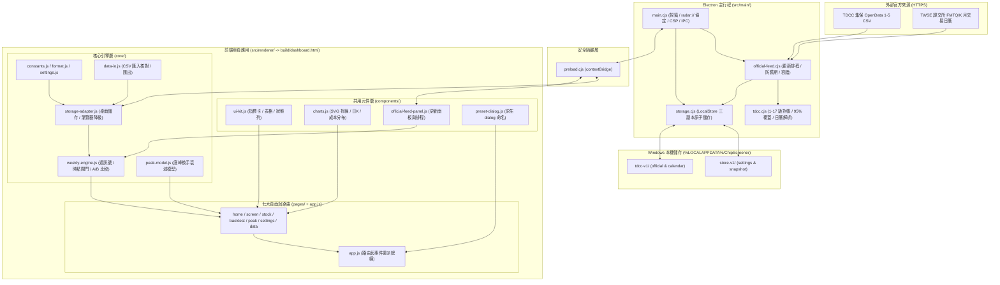
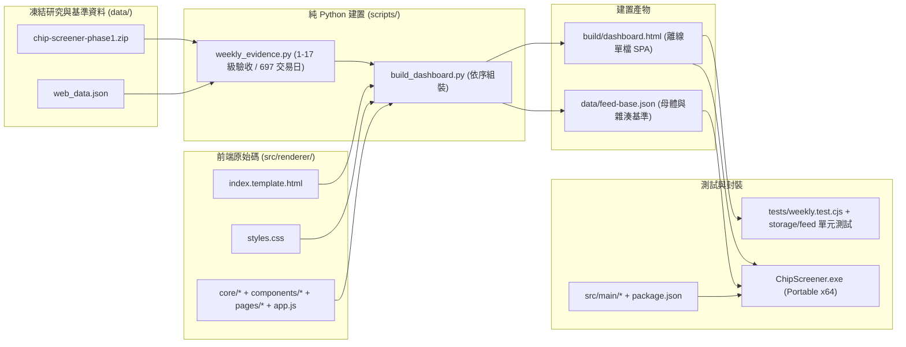
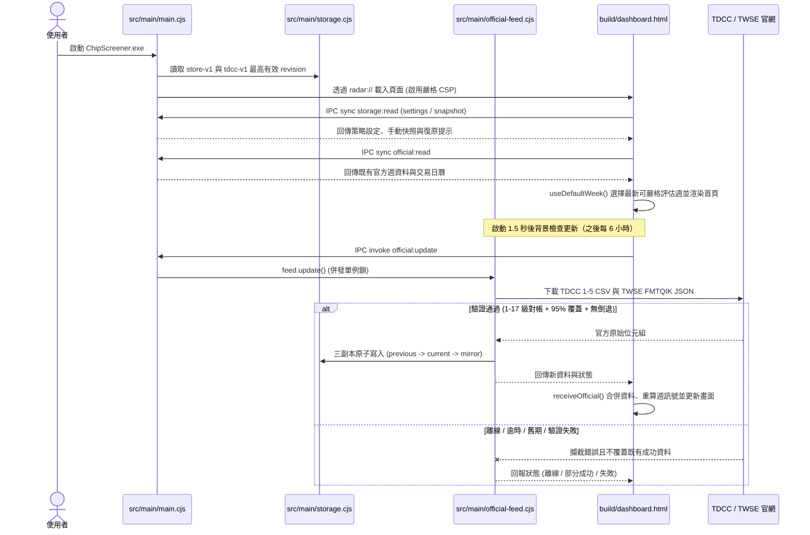
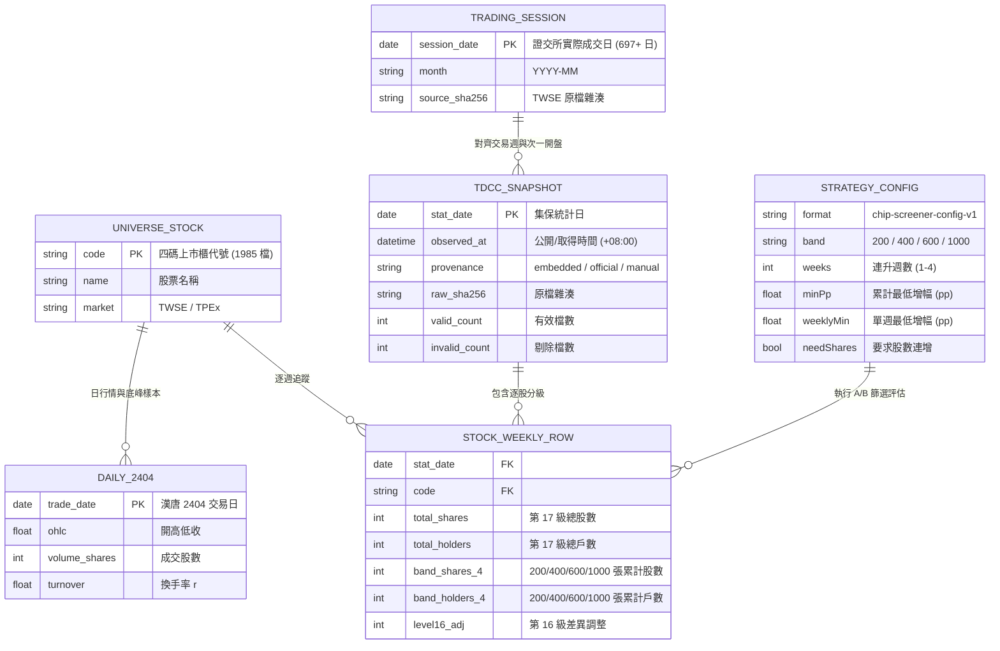

# 台股籌碼雷達 — 軟體工程架構與模組關係圖

本文檔說明重構後的模組分類、職責邊界、建置管線、執行期資料流與核心資料模型。

---

## 1. 系統分層架構圖（System Layered Architecture）

---

## 2. 建置與封裝依賴圖（Build & Packaging Pipeline）

重構後完全移除 `git apply` 與 `desktop.patch`，改由 `scripts/build_dashboard.py` 純 Python 組裝所有前端模組：

---

## 3. 執行期互動時序圖（Startup, Recovery & Background Update）

---

## 4. 核心領域資料模型（Domain ER Diagram）

